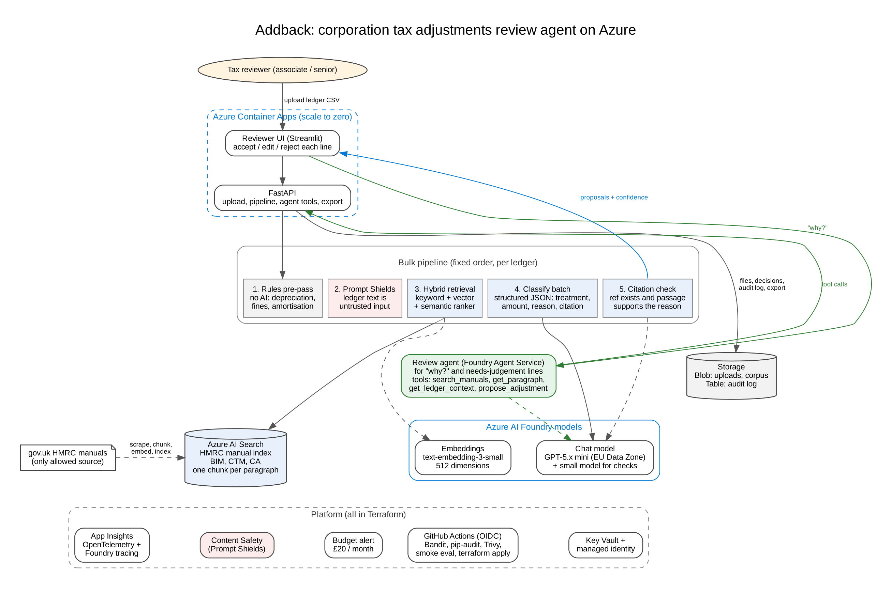

# Addback

**An AI agent that does a first-pass review of a UK company's nominal ledger for corporation tax adjustments, citing HMRC manuals, with a human reviewer approving every line.**


> **Status (October 2026):** design complete, build in progress. This README is updated as each milestone lands. Results tables are placeholders until the evaluation runs.

---

## Table of contents

1. [The problem](#the-problem)
2. [What Addback does](#what-addback-does)
3. [Architecture](#architecture)
4. [Tech stack](#tech-stack)
5. [Design decisions](#design-decisions)
6. [Evaluation](#evaluation)
7. [Security and responsible AI](#security-and-responsible-ai)
8. [Roadmap](#roadmap)
9. [Repo structure](#repo-structure)
10. [Getting started](#getting-started)
11. [Git workflow](#git-workflow)
12. [Author](#author)

---

## The problem

When preparing a UK company's corporation tax computation, tax staff go line by line through the trial balance or nominal ledger to find items that are not deductible for tax: client entertaining, fines, capital spend, depreciation, some legal fees. These are added back to accounts profit.

- The rules sit in HMRC's Business Income Manual (BIM), Company Taxation Manual (CTM) and Capital Allowances Manual (CA).
- Ledgers are messy. Every client codes expenses differently and descriptions are short ("Legal - Smith", "Xmas do").
- Computation software calculates the tax once adjustments are keyed in. It does not find them.
- Large firms have started building bespoke AI for this one client at a time. Mid-tier firms and their SME clients have nothing comparable.

More detail: [docs/research-brief.md](docs/research-brief.md).

## What Addback does

1. Takes a nominal ledger or trial balance export (CSV).
2. Tags certain items with fixed rules (no AI needed for depreciation or fines).
3. Checks every ledger description for prompt injection, because ledger text is untrusted input.
4. Retrieves the relevant HMRC manual paragraphs with hybrid search.
5. Classifies each remaining line as allowable, disallowable, capital or needs judgement, with an add-back amount, a reason, a manual citation and a confidence score.
6. Verifies that each citation exists and supports the reason. Anything that fails goes to "needs judgement".
7. Gives the reviewer a table to accept, edit or reject each line, plus an agent they can ask "why?".
8. Exports an adjustments schedule and an audit log.

Nothing is final without a human decision. This follows HMRC's January 2026 guidance on generative AI in tax software: transparent, legally grounded, human-supervised, secure and ethical.

## Architecture



- **Bulk pipeline (fixed order):** predictable, cheap and testable for 100+ ledger lines.
- **Review agent (Azure AI Foundry Agent Service):** used only where the path is not known in advance, such as explaining a decision or investigating an ambiguous line. Its tools can propose an adjustment but cannot finalise one.

Full design: [docs/design-doc.md](docs/design-doc.md).

## Tech stack

| Layer | Technology |
|---|---|
| LLM and agent | Azure OpenAI (GPT-5.x mini) via Azure AI Foundry, Foundry Agent Service |
| Embeddings | text-embedding-3-small (512 dimensions) |
| Retrieval | Azure AI Search: hybrid keyword and vector search, semantic ranker |
| Safety | Azure AI Content Safety (Prompt Shields), structured outputs with Pydantic validation |
| Backend | Python, FastAPI |
| Front end | Streamlit reviewer app |
| Hosting | Azure Container Apps (scale to zero), Azure Container Registry |
| Data | Azure Blob Storage (uploads, corpus), Azure Table Storage (audit log) |
| Identity and secrets | Managed identity, Azure Key Vault |
| Infrastructure as code | Terraform |
| CI/CD | GitHub Actions with OIDC, Bandit, pip-audit, Trivy, smoke evaluation |
| Observability | Application Insights, OpenTelemetry, Foundry tracing |
| Evaluation | Ragas, custom classification and citation metrics, ChromaDB baseline |

## Design decisions

Each decision is logged as Decision, Options, Choice, Why, Trade-offs in [docs/design-doc.md](docs/design-doc.md#4-decision-log). Highlights:

| Decision | Choice | Why |
|---|---|---|
| Core pattern | Fixed pipeline for bulk lines, agent for review | Agents earn their place only where the path is unknown |
| Rules before AI | Deterministic tags for certain items | No model cost or risk where the answer is fixed |
| Model and region | GPT-5.x mini, EU Data Zone, model names as Terraform variables | GPT-4.1 family retires October 2026; availability changes often |
| Search tier | Free for development, Basic only for the evaluation week | Semantic ranker needs Basic; keeps cost low |
| Chunking | One chunk per HMRC manual paragraph | Citations map to a paragraph ID and can be checked deterministically |
| Prompt injection | Prompt Shields, data delimiting, tools cannot finalise | Ledger descriptions are free text from client systems |

## Evaluation

Synthetic ledgers only. No client data.

| Metric | Target | Result |
|---|---|---|
| Recall on disallowable and capital lines | 0.90 or higher | Pending |
| Precision on disallowable and capital lines | 0.80 or higher | Pending |
| Citation accuracy | 0.90 or higher | Pending |
| Ragas faithfulness (manual Q&A set) | 0.85 or higher | Pending |
| Time per 150-line ledger | Under 2 minutes | Pending |
| Cost per ledger | Measured | Pending |
| Injected ledger lines neutralised | 3 of 3 | Pending |

**Managed vs self-built retrieval:** the same question set and ledgers run against Azure AI Search (hybrid, with and without semantic ranker) and a ChromaDB plus BM25 baseline. Comparison covers quality, setup time, monthly cost, control and debuggability.

## Security and responsible AI

- Retrieval restricted to gov.uk HMRC manuals. No web search.
- Every proposal shows its source paragraph and confidence. AI use is disclosed in the UI.
- Mandatory human review; the preparer remains responsible for the return.
- Managed identity instead of keys; secrets in Key Vault.
- Security gates in CI: Bandit, pip-audit, Trivy.
- Audit log of every reviewer decision.

## Roadmap

- [x] Problem research and target companies
- [x] Research brief
- [x] Design doc, decision log and architecture diagram
- [ ] Validate riskiest assumptions (model deployment, index size, 20-line classification test)
- [ ] Synthetic labelled ledgers and manual Q&A set
- [ ] Terraform for all Azure resources
- [ ] HMRC manual scraper and indexer
- [ ] Rules pre-pass, retrieval, classification, citation check
- [ ] FastAPI and Streamlit containers on Azure Container Apps
- [ ] GitHub Actions CI/CD with security gates
- [ ] Foundry review agent with tools
- [ ] Full evaluation and ChromaDB comparison
- [ ] Demo video and write-up

## Repo structure

```
addback/
├── app/
│   ├── api/          FastAPI: upload, pipeline, agent tools, export
│   ├── pipeline/     rules, retrieval, classification, citation check
│   ├── agent/        Foundry agent definition and tool wiring
│   └── ui/           Streamlit reviewer app
├── corpus/           HMRC manual scraper and indexer
├── eval/
│   ├── ledgers/      synthetic labelled ledgers
│   ├── qa/           manual Q&A set for Ragas
│   └── results/      evaluation outputs
├── infra/            Terraform for all Azure resources
├── docs/
│   ├── architecture.png
│   ├── architecture.dot
│   ├── design-doc.md
│   └── research-brief.md
└── README.md
```

## Getting started

Setup instructions will be added once the first deployable version lands. Planned flow:

```bash
# 1. Provision Azure resources
cd infra && terraform init && terraform apply

# 2. Build the HMRC manual index
make corpus

# 3. Run locally
make dev

# 4. Run the evaluation
make eval
```

## Git workflow

```bash
# First push (new repo)
git init
git add .
git commit -m "Initial commit: design, architecture and repo skeleton"
git branch -M main
git remote add origin https://github.com/seyiabello/addback.git
git push -u origin main

# Day-to-day
git checkout -b feature/<name>
git add .
git commit -m "<what changed>"
git push -u origin feature/<name>
# open a pull request on GitHub, let CI pass, then merge
```

## Author

**Oluwaseyi Bello**, AI engineer, London. MSc Human-Centred AI, University of Exeter.
GitHub: [@seyiabello](https://github.com/seyiabello)

*This is a portfolio project. It is not tax advice, and it is not affiliated with HMRC or any accounting firm.*
